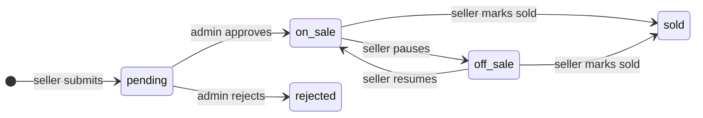
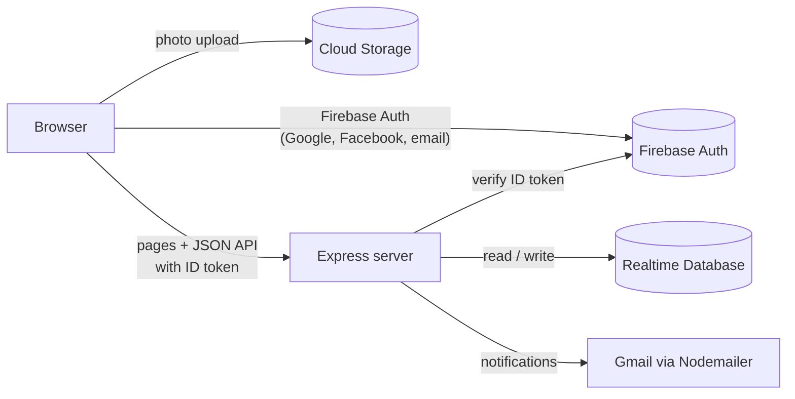

<div align="center">

# GG Marketplace

**A peer-to-peer marketplace where people list items, browse what's for sale, and get in touch with sellers.**

Built with Node.js, Express, and Firebase. Runs as a container or as a Firebase Cloud Function.


</div>

<!--
## Screenshots

Drop images into docs/screenshots/ and uncomment this section.

<p align="center">
  
  
</p>
<p align="center">
  
  
</p>
-->

## Features

**For buyers**
- Browse the latest listings on the home feed, or search by name and description
- View a product page with photos, price, and the seller's public profile
- Register interest in an item or message the seller directly; the seller gets an email notification

**For sellers**
- Sign in with Google, Facebook, or email and password
- List an item with a photo, which is uploaded straight to Cloud Storage
- Manage listings from a personal dashboard: edit details, pause or resume a listing, or mark it sold
- Save a shipping address to your profile

**For moderators**
- Every new listing lands in an admin review queue and only goes live once approved

## How it works

### Listing lifecycle



Only `on-sale` listings appear in the feed and in search.

### Architecture



- **Server-rendered pages.** Express renders EJS templates, so pages arrive with content already in them and work without a client framework.
- **Token-checked API.** The browser signs in with the Firebase client SDK and sends its ID token with every write. The server checks it with the Firebase Admin SDK before touching the database, and checks that the caller owns the listing for edits, pausing, and sales.
- **Two ways to deploy.** The same app ships as a standalone Express server (`server.js`, containerized with Docker and PM2) and as a Firebase Cloud Function behind Firebase Hosting (`functions/index.js`).

## Tech stack

| Layer | Tools |
| --- | --- |
| Server | Node.js, Express, EJS, Morgan |
| Auth | Firebase Authentication (Google, Facebook, email and password) |
| Data | Firebase Realtime Database, Cloud Storage for product images |
| Email | Nodemailer over Gmail |
| Hosting | Docker + PM2, or Firebase Hosting + Cloud Functions |

## Project structure

```text
.
├── server.js               # Standalone Express app (Docker entry point)
├── Dockerfile
├── firebase.json           # Hosting config: rewrites all routes to the function
├── functions/
│   ├── index.js            # Same app, exported as a Cloud Function
│   └── views/              # EJS templates, CSS, client JS, fonts, media
│       ├── partials/
│       └── js/             # Firebase client: auth and database helpers
├── views -> functions/views
└── public/                 # Static Firebase Hosting files
```

## Getting started

### Prerequisites

- Node.js
- A Firebase project with Authentication, Realtime Database, and Cloud Storage enabled
- A Firebase Admin service account key
- A Gmail account with an app password, for outgoing notifications

### Configuration

Credentials are not committed. Provide them locally:

| What | Where |
| --- | --- |
| Service account key (standalone server) | `secrets/project-gg-3b754-firebase-adminsdk-4848h-5a5778b77b.json` |
| Service account key (Cloud Function) | `functions/project-gg-3b754-firebase-adminsdk-4848h-5a5778b77b.json` |
| Gmail sender address | `GMAIL_USER` env var (defaults to `noreply.projectgg@gmail.com`) |
| Gmail app password | `GMAIL_APP_PASSWORD` env var |

To use your own Firebase project, update the client config in `functions/views/js/fInit.js`, the `databaseURL` in `server.js` and `functions/index.js`, and the project ID in `.firebaserc`.

### Run locally

```bash
npm install
GMAIL_APP_PASSWORD=your-app-password npm start
```

Then open http://localhost:5001.

### Run with Docker

```bash
docker build -t gg-marketplace .
docker run -p 5001:5001 -e GMAIL_APP_PASSWORD=your-app-password gg-marketplace
```

### Deploy to Firebase

```bash
cd functions && npm install && cd ..
npx firebase deploy
```

`functions/package.json` still targets the Node 8 runtime from 2020, which Cloud Functions no longer accepts. Bump `engines.node` to a supported version before deploying.

## Status

GG started as a 2020 prototype. It's kept here as a portfolio piece and isn't running in production.
